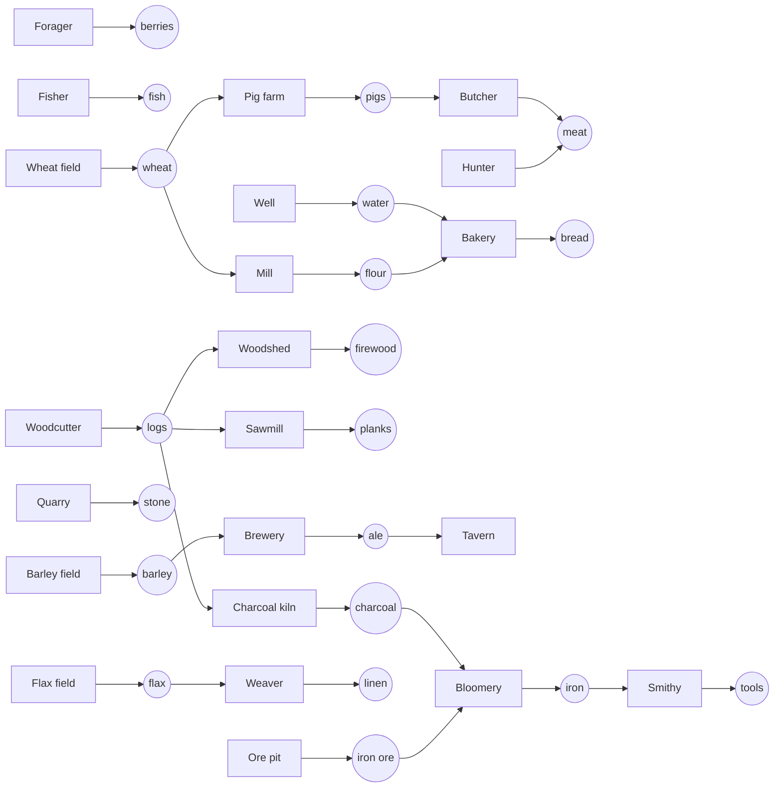

# Hearthlands: village supply chains (medieval age)

**Status:** design proposal. This extends [DESIGN.md](DESIGN.md) for milestone 2 onward. It does not change the milestone 1 data in `data/`. Section 9 lists the data and sim changes needed to adopt it.

Building ids, goods ids, `cycle_ticks`, `workers`, `unlock_tier` and `cost` use the same names and meanings as `data/buildings.json`. 10 ticks = 1 second. All numbers are first-pass balance values to be tuned by the headless harness.

---

## 1. Design rules

1. **Four links at most.** A chain runs from a raw producer to a finished good through no more than four buildings. Side inputs such as fuel, water and salt do not add links. No building takes more than three input goods.
2. **No dead ends.** Every good has at least one consumer: a house need, a service, construction, another recipe, a comfort or an export.
3. **Core chains are enough.** Core chains alone take any *normal* site to Tier 3 and charter, with no imports. Location chains are never required for Tier 3. They add comforts, better substitutes, export value and faction favour.
4. **Needs use categories.** A need asks for a category (staple food, fuel, cloth, masonry), and any good in that category satisfies it. This is how a local resource replaces a core one, for example peat for firewood or woollens for linen.
5. **Unlock before you need it.** Chains with three or more buildings unlock one tier before the need that consumes their output. Short chains may unlock at the same tier, covered by the downgrade grace period. Bread in milestone 1 is an example of a short chain unlocking at the tier that needs it.
6. **Harsh sites depend on their rare resource.** Marsh, mountain and tundra sites lack some core deposits. Their rare resource is what lets them survive, as well as what makes them valuable.
7. **Some chains require imports by design.** A location chain whose deposits never appear in the same biome cannot be completed by one village. This gives the nation layer real goods to move.
8. **7–10 chains per village.** A village runs 7–10 chains: the core chains it builds plus 1–3 location chains from its signature deposits. The age as a whole can hold more, because each village sees only the location chains its map allows. A one-building source such as a well or peat cutter does not count as a chain.

## 2. Resource rarity

| Class | Where it appears | Generator rule |
| --- | --- | --- |
| **Core** | Every site | Always placed. Some deposits are finite (marked †). |
| **Uncommon** | Normal and harsh biomes | Each site rolls 1–2 *signature deposits* from its biome's pool. |
| **Rare** | Harsh biomes, plus sea salt on some ocean coasts | Each harsh site gets 1 rare deposit, plus a 25% chance of a second. Coast sites have a 20% chance of `sea_salt_flats`. |

### Deposits

| Deposit | Class | Terrain | Gives | Notes |
| --- | --- | --- | --- | --- |
| `fresh_water` | Core | grass | water | Wells work on any grass tile. |
| `fertile_soil` | Core | grass | wheat, barley, flax, pig feed | Already generated. Fields elsewhere produce at half speed. |
| `timber` | Core | forest | logs, pitch | Already generated. |
| `wild_berries` † | Core | forest edge | berries | Bushes regrow 1 per 300 ticks, up to 40 per patch. |
| `game` † | Core | forest | meat | Pool of 30 per forest region; regrows 1 per 400 ticks. |
| `shallows` | Core | shore | fish | Low-yield fishing on any water edge. |
| `stone_outcrop` † | Core | grass/hill | stone | One outcrop of 200 stone per site. |
| `surface_iron` † | Core | grass/hill | iron ore | One seam of 150 ore per site. Enough for Tier 3, not for an iron economy. |
| `clay_bank` | Uncommon | river/shore | clay | |
| `iron_vein` | Uncommon | hill | iron ore | Rich: 1,500 ore. |
| `fish_shoals` | Uncommon | water | fish | Fishers here work at double speed. Enables salt fish. |
| `pasture` | Uncommon | grass/hill | wool, milk | |
| `sunny_slope` | Uncommon | hill | grapes | |
| `flower_heath` | Uncommon | grass | honey, wax | |
| `dye_meadow` | Uncommon | grass/marsh | woad | |
| `oak_grove` | Uncommon | forest | oak | Old-growth hardwood; regrows slowly. |
| `peat_bog` | Rare | marsh | peat | |
| `salt` | Rare | marsh (brine pans), mountain (rock salt) | brine | Inland salt; must be boiled with fuel. |
| `sea_salt_flats` | Rare | ocean shore (coast, tundra) | salt | Only on `ocean`-edge tiles, never lakes or rivers. Evaporation pans make salt directly, without fuel, but slowly. |
| `coal_seam` | Rare | mountain | coal | |
| `silver_lode` | Rare | mountain | silver ore | |
| `trapline` | Rare | tundra forest | pelts | |
| `amber_shore` | Rare | tundra shore | amber | |

### Biomes and signature pools

| Biome | Type | Uncommon pool (weight) | Rare pool | Core shortfall |
| --- | --- | --- | --- | --- |
| Heartland | Normal | sunny_slope 3, flower_heath 3, pasture 2, dye_meadow 2, clay_bank 1 | — | — |
| Riverland | Normal | fish_shoals 3, clay_bank 3, oak_grove 2, dye_meadow 1 | — | — |
| Coast | Normal | fish_shoals 4, oak_grove 2, clay_bank 1, pasture 1 | sea_salt_flats (20% chance, extra to signatures) | Less fertile soil |
| Highland hills | Normal | iron_vein 3, pasture 3, oak_grove 1, sunny_slope 1 | — | Less fertile soil |
| Marsh | Harsh | clay_bank 2, dye_meadow 2, fish_shoals 1 | peat_bog, salt | Little timber or fertile soil |
| Mountain pass | Harsh | iron_vein 3, pasture 2 | coal_seam, silver_lode, salt | Little grass; no fertile soil |
| Tundra | Harsh | fish_shoals 2, pasture 1 | trapline 5, amber_shore 4, sea_salt_flats 1 (ocean-edge sites only) | Fields at half speed; no fertile soil |

Culture affinity follows [DESIGN.md](DESIGN.md): **Highland clans** favour hills and mountain passes, **River folk** favour riverland, coast and marsh, and **Abbey settlers** favour the heartland. Cultures are regional flavour only; they no longer decide factions ([FACTIONS.md](FACTIONS.md) §13).

## 3. Goods

Categories: **B** basic food · **S** staple food · **F** fuel · **C** cloth · **M** masonry · **X** comfort

| Id | Name | Class | Categories | Main consumers |
| --- | --- | --- | --- | --- |
| water | Water | Core | | All tiers, bakery, pig farm, brewery, meadery |
| berries | Berries | Core | B | Tier 1 |
| fish | Fish | Core | B, S | Tiers 1–3, smokehouse |
| meat | Meat | Core | B, S | Tiers 1–3 |
| wheat | Wheat | Core | | Mill, pig farm |
| flour | Flour | Core | | Bakery |
| bread | Bread | Core | S | Tiers 2–3 |
| pigs | Pigs | Core | | Butcher |
| barley | Barley | Core | | Brewery |
| ale | Ale | Core | | Tavern |
| logs | Logs | Core | | Construction, woodshed, sawmill, charcoal, tar kiln |
| firewood | Firewood | Core | F | Tiers 2–3, kilns, saltern, smokehouse |
| charcoal | Charcoal | Core | F | Bloomery, smelter (also burnable as fuel) |
| planks | Planks | Core | | Tier 2–3 construction, weaponsmith |
| stone | Stone | Core | M | Tier 2–3 construction |
| flax | Flax | Core | | Weaver, weaving hall |
| linen | Linen | Core | C | Tier 3, shipwright |
| iron_ore | Iron ore | Core/Uncommon | | Bloomery |
| iron | Iron | Core | | Smithy, steelworks |
| tools | Tools | Core | | Tier 3, Tier 3 construction |
| pitch | Pitch | Core | | Shipwright |
| clay | Clay | Uncommon | | Brick kiln, potter |
| bricks | Bricks | Uncommon | M | Construction (renewable, unlike stone) |
| pottery | Pottery | Uncommon | X | Comfort, export |
| brine | Brine | Rare | | Saltern |
| salt | Salt | Rare | | Smokehouse, dairy, fur tannery, export (from saltern or salt pan) |
| salt_fish | Salt fish | Uncommon+Rare | S, X | Food, comfort; does not spoil (seasons) |
| wool | Wool | Uncommon | | Loom house |
| milk | Milk | Uncommon | | Dairy |
| cheese | Cheese | Uncommon+Rare | S, X | Food, comfort |
| woollens | Woollens | Uncommon | C | Tier 3, dyer, furrier |
| woad | Woad | Uncommon | | Dyer |
| fine_cloth | Fine cloth | Uncommon×2 | C, X | Comfort, export |
| honey | Honey | Uncommon | | Meadery |
| wax | Wax | Uncommon | | Chandler |
| candles | Candles | Uncommon | X | Chapel upgrade, comfort |
| mead | Mead | Uncommon | X | Tavern alternative, comfort |
| grapes | Grapes | Uncommon | | Winery |
| oak | Oak | Uncommon | | Cooper, shipwright |
| barrels | Barrels | Uncommon | | Winery, export |
| wine | Wine | Uncommon×2 | X | Comfort, export |
| riverboat | Riverboat | Uncommon | | Nation-layer route capacity |
| peat | Peat | Rare | F | Fuel |
| coal | Coal | Rare | F | Steelworks, smelter, fuel |
| steel | Steel | Uncommon+Rare | | Weaponsmith |
| arms | Arms | Uncommon+Rare | | Village defence, garrison charter |
| silver_ore | Silver ore | Rare | | Smelter |
| silver | Silver | Rare | | Jeweller, export |
| amber | Amber | Rare | | Jeweller, export |
| jewellery | Jewellery | Rare×2 | X | Comfort, export |
| pelts | Pelts | Rare | | Fur tannery |
| furs | Furs | Rare×2 | | Furrier, export |
| fur_cloak | Fur cloak | Rare×2 + Uncommon | C, X | Cloth with a cold-season bonus |

## 4. Needs tiers (proposed `tiers.json`)

| Tier | Basket | Interval | Services | Unlocks |
| --- | --- | --- | --- | --- |
| 1 · Settlers | 1 water, 1 **B** | 100 | shelter | house, storehouse, road, well, woodcutter, farm, forager, hunter, fisher |
| 2 · Villagers | 1 water, 1 **S**, 1 **F** | 200 | chapel | mill, bakery, pig farm, butcher, woodshed, sawmill, quarry, chapel, barley field, brewery, flax field, weaver, charcoal kiln, ore pit, bloomery, smithy, tavern, all Tier 2 location buildings |
| 3 · Townsfolk | 1 water, 2 **distinct S**, 1 **F**, 1 **C** · plus 1 tools every 3,000 ticks | 300 | chapel, market, tavern | market, export depot, tar kiln, weaving hall upgrade, all Tier 3 location buildings |

**Comforts (Tier 3, optional).** Each distinct **X** good a house receives at least once every 600 ticks adds +1 morale. Comforts never cause demotion. Morale feeds the failure rule ("morale collapses for a full season") and the charter score. Comfort goods are mostly what location chains produce.

**Tools wear slowly** so that the guaranteed 150-ore surface seam supports roughly 10 Tier 3 houses for an hour-long run. A site with an `iron_vein`, or tools imported from one, removes that ceiling.

## 5. Core chains

Every village can build these. Construction-cost bands: Tier 1 uses logs only. Tier 2 uses logs plus planks, with stone for heavy buildings. Tier 3 uses planks, masonry and tools.

### C1 · Water and wild food (Tier 1)
| Id | Name | Recipe | Cycle | Workers | Site rule | Tier | Cost |
| --- | --- | --- | --- | --- | --- | --- | --- |
| well | Well | → 1 water | 25 | 1 | grass | 1 | 3 logs |
| forager | Forager's hut | → 1 berries | 40 | 1 | within 3 tiles of `wild_berries` | 1 | 3 logs |
| hunter | Hunter's lodge | → 1 meat | 80 | 1 | within 4 tiles of forest; draws on the `game` pool | 1 | 4 logs |
| fisher | Fisher's hut | → 1 fish | 60 (30 on shoals) | 1 | touches water | 1 | 4 logs |

Gathering is finite or slow on purpose. It sustains Tier 1, but pushes the player toward farming before Tier 2.

### C2 · Bread (existing milestone 1 chain)
| Id | Name | Recipe | Cycle | Workers | Site rule | Tier | Cost |
| --- | --- | --- | --- | --- | --- | --- | --- |
| farm | Wheat field | → 1 wheat | 35 | 2 | grass; half speed off `fertile_soil` | 1 | 4 logs |
| mill | Windmill | 1 wheat → 1 flour | 45 | 2 | grass | 2 | 8 logs |
| bakery | Bakery | 1 flour + 1 water → 1 bread | 50 | 2 | grass | 2 | 8 logs |

### C3 · Meat
| Id | Name | Recipe | Cycle | Workers | Site rule | Tier | Cost |
| --- | --- | --- | --- | --- | --- | --- | --- |
| pig_farm | Pig farm | 1 wheat + 1 water → 1 pigs | 70 | 2 | grass | 2 | 6 logs, 2 planks |
| butcher | Butcher | 1 pigs → 2 meat | 50 | 1 | grass | 2 | 6 logs, 2 planks |

Meat competes with bread for wheat. That is the Tier 2 trade-off, and it matters at Tier 3, which needs two *distinct* staples.

### C4 · Fuel
| Id | Name | Recipe | Cycle | Workers | Site rule | Tier | Cost |
| --- | --- | --- | --- | --- | --- | --- | --- |
| woodcutter | Woodcutter | → 1 logs | 65 | 2 | grass/forest, near `timber` | 1 | 4 logs |
| woodshed | Woodshed | 1 logs → 2 firewood | 30 | 1 | any | 2 | 4 logs |
| charcoal_kiln | Charcoal kiln | 2 logs → 1 charcoal | 60 | 1 | within 3 tiles of forest | 2 | 4 logs, 2 stone |

This replaces milestone 1's "logs stand in for firewood".

### C5 · Building materials
| Id | Name | Recipe | Cycle | Workers | Site rule | Tier | Cost |
| --- | --- | --- | --- | --- | --- | --- | --- |
| sawmill | Sawmill | 1 logs → 1 planks | 40 | 2 | grass | 2 | 8 logs |
| quarry | Quarry | → 1 stone | 60 | 2 | on `stone_outcrop` † | 2 | 8 logs |

Stone is finite: 200 per site. Masonry for Tier 3 buildings can also be bricks (L1), which never run out. This is the clearest early reason to value a clay bank.

### C6 · Ale and the tavern
| Id | Name | Recipe | Cycle | Workers | Site rule | Tier | Cost |
| --- | --- | --- | --- | --- | --- | --- | --- |
| barley_field | Barley field | → 1 barley | 40 | 2 | grass; half speed off `fertile_soil` | 2 | 4 logs |
| brewery | Brewery | 1 barley + 1 water → 1 ale | 60 | 2 | grass | 2 | 6 logs, 4 planks |

### C7 · Cloth
| Id | Name | Recipe | Cycle | Workers | Site rule | Tier | Cost |
| --- | --- | --- | --- | --- | --- | --- | --- |
| flax_field | Flax field | → 1 flax | 40 | 2 | grass; half speed off `fertile_soil` | 2 | 4 logs |
| weaver | Weaver's cottage | 2 flax → 1 linen | 60 | 2 | grass | 2 | 6 logs, 4 planks |
| weaving_hall | Weaving hall (upgrade of `weaver`) | 2 flax → 1 linen **or** 2 wool → 1 woollens | 60 | 3 | same footprint | 3 | upgrade: 4 planks, 2 masonry, 1 tools |

**Two separate buildings, one upgrade.** The weaver's cottage weaves only linen, and the loom house (L4) weaves only woollens. A weaver's cottage can be upgraded in place to a **weaving hall** that does both. Each cycle it runs whichever recipe has inputs ready. If both are ready, it alternates, starting with the recipe the player has pinned. The hall's input slots are shared, and carriers are allowed up to half the capacity for each fibre, so one fibre cannot starve the other. The loom house cannot be upgraded. A pasture village that wants one building for both fibres starts from a weaver's cottage.

Upgrading keeps the building's position, staff and stock. Production pauses for 100 ticks while the upgrade is built.

Grain, barley and flax all want fertile soil. Field placement is the main spatial puzzle in heartland runs.

### C8 · Iron and tools
| Id | Name | Recipe | Cycle | Workers | Site rule | Tier | Cost |
| --- | --- | --- | --- | --- | --- | --- | --- |
| ore_pit | Ore pit | → 1 iron_ore | 70 | 2 | on `surface_iron` † or `iron_vein` | 2 | 6 logs, 2 planks |
| bloomery | Bloomery | 1 iron_ore + 1 charcoal → 1 iron | 80 | 2 | grass | 2 | 4 planks, 6 stone |
| smithy | Smithy | 1 iron + 1 logs → 1 tools | 70 | 2 | grass | 2 | 4 planks, 4 stone |

### C9 · Services
| Id | Name | Consumes | Workers | Radius | Tier | Cost |
| --- | --- | --- | --- | --- | --- | --- |
| chapel | Chapel | — (candles optional: Lit chapel comfort, 1 per 300) | 1 | 8 | 2 | 6 planks, 6 stone |
| tavern | Tavern | 1 ale **or** 1 mead per 150 | 2 | 8 | 2 | 6 planks, 4 stone |
| market | Market | — (houses in radius may mix their staples from any reachable storehouse) | 2 | 10 | 3 | 6 planks, 6 masonry |
| export_depot | Export depot | Any goods marked for export | 2 | — | 3 | 8 planks, 8 masonry, 4 tools |

A house receives a service when it is inside the service building's radius *and* the building is staffed and supplied.

## 6. Location chains

Each location chain is marked with the deposits it needs. Chains needing **two or more** uncommon or rare deposits are marked ★. These are the chains that pull villages into trade.

### L1 · Clay: bricks and pottery `clay_bank`
| Id | Name | Recipe | Cycle | Workers | Site rule | Tier |
| --- | --- | --- | --- | --- | --- | --- |
| clay_pit | Clay pit | → 1 clay | 40 | 2 | on `clay_bank` | 2 |
| brick_kiln | Brick kiln | 2 clay + 1 **F** → 2 bricks | 70 | 2 | grass | 2 |
| potter | Potter | 1 clay + 1 **F** → 1 pottery | 80 | 1 | grass | 3 |

*Role:* renewable masonry, plus a cheap comfort good. A clay village can build a stone-free Tier 3 settlement.

### L2 · Salt `salt` or `sea_salt_flats`
| Id | Name | Recipe | Cycle | Workers | Site rule | Tier |
| --- | --- | --- | --- | --- | --- | --- |
| brine_works | Brine works | → 1 brine | 40 | 1 | on `salt` | 2 |
| saltern | Saltern | 2 brine + 1 **F** → 1 salt | 60 | 2 | grass/marsh | 2 |
| salt_pan | Salt pan | → 1 salt | 120 (240 on tundra) | 2 | on `sea_salt_flats`, touches `ocean` | 2 |

*Role:* salt is an **enabler**. It is not consumed by houses itself, but it is an input to L3, L4b and L11. There are two ways to make it:
- **Inland salt** (marsh, mountain) is fast, but every unit costs fuel. Marsh salterns burn local peat (L8), so a marsh village can make salt on its own.
- **Sea salt** (some ocean coasts, rarely tundra) needs no fuel and only one building, but is slow. Tundra pans work at half speed because the weak sun evaporates less water.

Most villages still have to import salt, which makes it the medieval nation's first real trade good.

### L3 · Salt fish ★ `fish_shoals` + `salt`
| Id | Name | Recipe | Cycle | Workers | Site rule | Tier |
| --- | --- | --- | --- | --- | --- | --- |
| smokehouse | Smokehouse | 2 fish + 1 salt + 1 **F** → 2 salt_fish | 80 | 2 | grass/shore | 3 |

*Role:* a staple that **does not spoil over winter** once seasons arrive, and the River folk's signature export. Riverland sites have the shoals but must import salt. Coast sites that roll sea salt flats (about 1 in 5) and marsh sites with shoals can complete the whole chain. These are the River folk's prize sites.

### L4 · Pasture `pasture`
| Id | Name | Recipe | Cycle | Workers | Site rule | Tier |
| --- | --- | --- | --- | --- | --- | --- |
| sheepfold | Sheepfold | → 1 wool + 1 milk | 60 | 2 | on `pasture` | 2 |
| loom_house | Loom house | 2 wool → 1 woollens | 60 | 2 | grass | 2 |

**L4b · Cheese ★** `pasture` + `salt`
| Id | Name | Recipe | Cycle | Workers | Site rule | Tier |
| --- | --- | --- | --- | --- | --- | --- |
| dairy | Dairy | 2 milk + 1 salt → 2 cheese | 80 | 2 | grass | 3 |

*Role:* woollens are cloth that frees fertile soil from flax. A Tier 3 village that has both fibres can replace its cottage and loom house with one weaving hall (see C7). Cheese is a staple and a comfort. Without salt, milk has no use, so a pasture village's surplus becomes a reason to trade.

### L5 · Fine cloth ★ `pasture` + `dye_meadow`
| Id | Name | Recipe | Cycle | Workers | Site rule | Tier |
| --- | --- | --- | --- | --- | --- | --- |
| woad_garden | Woad garden | → 1 woad | 50 | 1 | on `dye_meadow` | 3 |
| dyer | Dyer's yard | 1 woollens + 1 woad + 1 water → 1 fine_cloth | 90 | 2 | touches water | 3 |

*Role:* high-value cloth and comfort good, and a luxury for elite households (FACTIONS.md §8). Heartland sites can roll both deposits. Elsewhere, woollens or woad must be imported.

### L6 · Apiary: candles and mead `flower_heath`
| Id | Name | Recipe | Cycle | Workers | Site rule | Tier |
| --- | --- | --- | --- | --- | --- | --- |
| apiary | Apiary | → 1 honey + 1 wax | 90 | 1 | on `flower_heath` | 2 |
| chandler | Chandler | 1 wax → 1 candles | 60 | 1 | grass | 2 |
| meadery | Meadery | 2 honey + 1 water → 1 mead | 80 | 2 | grass | 3 |

*Role:* one deposit, two branches. Candles light the chapel (comfort). Mead replaces ale at the tavern and counts as a comfort, so an apiary village can skip barley entirely.

### L7 · Wine ★ `sunny_slope` + `oak_grove`
| Id | Name | Recipe | Cycle | Workers | Site rule | Tier |
| --- | --- | --- | --- | --- | --- | --- |
| vineyard | Vineyard | → 1 grapes | 50 | 2 | on `sunny_slope` | 3 |
| oak_forester | Oak forester | → 1 oak | 90 | 2 | on `oak_grove` | 2 |
| cooper | Cooper | 1 oak → 2 barrels | 60 | 1 | grass | 2 |
| winery | Winery | 3 grapes + 1 barrels → 2 wine | 100 | 2 | grass | 3 |

*Role:* the heartland's prestige chain and its most valuable export. Wine is also a luxury for elite households (FACTIONS.md §8). Vineyards favour heartland and hills, and oak favours riverland and coast. Wine villages usually import barrels, which gives oak villages a good to sell even without vineyards.

### L8 · Peat `peat_bog`
| Id | Name | Recipe | Cycle | Workers | Site rule | Tier |
| --- | --- | --- | --- | --- | --- | --- |
| peat_cutter | Peat cutter | → 2 peat | 50 | 2 | on `peat_bog` | 1 |

*Role:* a one-building chain, deliberately. Marsh sites have almost no timber, so peat is how they meet the Tier 2 fuel need at all. It unlocks at Tier 1 because the marsh cannot wait. It also fuels the saltern and brick kiln.

### L9 · Steel and arms ★ `iron_vein` + `coal_seam`
| Id | Name | Recipe | Cycle | Workers | Site rule | Tier |
| --- | --- | --- | --- | --- | --- | --- |
| coal_pit | Coal pit | → 1 coal | 60 | 2 | on `coal_seam` | 2 |
| steelworks | Steelworks | 2 iron + 1 coal → 1 steel | 100 | 3 | grass/hill | 3 |
| weaponsmith | Weaponsmith | 1 steel + 1 planks → 1 arms | 120 | 2 | grass/hill | 3 |

*Role:* arms raise village defence against raids and are the Garrison charter's export. The surface-iron seam cannot sustain this chain; it needs a vein. Mountain passes can roll both deposits but have little timber for planks. Highland hills have iron but must import coal.

### L10 · Silver and jewellery ★ `silver_lode` + `amber_shore` (always needs imports)
| Id | Name | Recipe | Cycle | Workers | Site rule | Tier |
| --- | --- | --- | --- | --- | --- | --- |
| silver_mine | Silver mine | → 1 silver_ore | 80 | 3 | on `silver_lode` | 2 |
| smelter | Smelter | 2 silver_ore + 1 **F** → 1 silver | 100 | 2 | grass/hill | 3 |
| amber_gatherer | Amber gatherer | → 1 amber | 90 | 1 | on `amber_shore` | 2 |
| jeweller | Jeweller | 1 silver + 1 amber → 1 jewellery | 150 | 2 | grass | 3 |

*Role:* the most valuable good in the age and the Market charter's showpiece. Silver is only in mountains and amber is only on tundra shores, so **no single village can complete this chain**. One village must export raw silver or amber to the other, or both must ship to a third village with a jeweller. Raw silver and amber are also exportable on their own.

### L11 · Furs ★ `trapline` + `salt` (+ woollens)
| Id | Name | Recipe | Cycle | Workers | Site rule | Tier |
| --- | --- | --- | --- | --- | --- | --- |
| trapper | Trapper's lodge | → 1 pelts | 70 | 1 | on `trapline` | 1 |
| fur_tannery | Fur tannery | 2 pelts + 1 salt → 2 furs | 80 | 2 | touches water | 2 |
| furrier | Furrier | 1 furs + 1 **C** → 1 fur_cloak | 100 | 1 | grass | 3 |

*Role:* fur cloaks count as cloth and give a cold-season bonus once seasons exist. Most tundra villages must import salt, so it is their lifeline import. A rare tundra site on an ocean shore with sea salt flats can make its own furs from start to finish, slowly. Those sites are worth seeking out.

### L12 · Riverboats `oak_grove` (+ core pitch and linen)
| Id | Name | Recipe | Cycle | Workers | Site rule | Tier |
| --- | --- | --- | --- | --- | --- | --- |
| tar_kiln | Tar kiln | 2 logs → 1 pitch | 70 | 1 | within 3 tiles of forest | 3 |
| shipwright | Shipwright | 3 oak + 1 pitch + 2 linen → 1 riverboat | 300 | 4 | touches water | 3 |

*Role:* a nation-layer good. An exported riverboat raises route capacity from that node. It is never consumed inside the village.

## 7. Location-chain dependency matrix

| Chain | clay | iron vein | fish shoals | pasture | sunny slope | heath | dye | oak | peat | salt | coal | silver | trapline | amber | Self-sufficient biome |
| --- | :-: | :-: | :-: | :-: | :-: | :-: | :-: | :-: | :-: | :-: | :-: | :-: | :-: | :-: | --- |
| L1 Clay | ● | | | | | | | | | | | | | | Riverland, Marsh |
| L2 Salt | | | | | | | | | ○ | ● | | | | | Marsh, Mountain; Coast and Tundra with sea salt flats |
| L3 Salt fish ★ | | | ● | | | | | | | ● | | | | | Coast with sea salt flats; Marsh (rare roll) |
| L4 Pasture | | | | ● | | | | | | | | | | | Heartland, Hills |
| L4b Cheese ★ | | | | ● | | | | | | ● | | | | | Mountain (rare roll) |
| L5 Fine cloth ★ | | | | ● | | | ● | | | | | | | | Heartland |
| L6 Apiary | | | | | | ● | | | | | | | | | Heartland |
| L7 Wine ★ | | | | | ● | | | ● | | | | | | | Hills (rare roll) |
| L8 Peat | | | | | | | | | ● | | | | | | Marsh |
| L9 Steel ★ | | ● | | | | | | | | | ● | | | | Mountain |
| L10 Jewellery ★ | | | | | | | | | | | | ● | | ● | **None: always needs imports** |
| L11 Furs ★ | | | | | | | | | | ● | | | ● | | Tundra with sea salt flats only (rare); otherwise imports salt |
| L12 Riverboats | | | | | | | | ● | | | | | | | Riverland, Coast |

● required · ○ local fuel substitute · the salt column covers both `salt` and `sea_salt_flats`

**Hub goods.** Salt feeds three chains and woollens feed three (L5, L11, cloth). These are the goods most likely to become the subject of faction demands and raids on trade routes.

## 8. Exports and faction demand

**Faction demands** now come from [FACTIONS.md](FACTIONS.md). The culture factions and their demand table were replaced on 15 Oct 2026. Location goods still matter to factions: town manors want luxuries such as wine and fine cloth, and supplying a faction's households raises its favour (FACTIONS.md §8).

Export value per unit, for the charter bundle: core goods 1, uncommon finished goods 3, single-rare goods 4, ★ goods 6, jewellery 10. A village's specialty is the location chain its signature deposits allow. Charter roles map naturally: **Producer** (L1, L4, L6, L7), **Garrison** (L9, L11), **Market** (L3, L5, L10, L12).

## 9. What adopting this needs

| Area | Change |
| --- | --- |
| `goods.json` | Add `class` (core/uncommon/rare) and `categories` (array). |
| `tiers.json` | Allow category entries in `consumption`, with a `distinct` count, for example `{"category":"staple","amount":2,"distinct":true}`. Allow a per-line `every_ticks` (tools). Add `comforts`. Move chapel, market and tavern into `services`. |
| `buildings.json` | Add `deposit` (the footprint must cover at least one tile of it), `adjacent_terrain` (for example `water` for fishers and dyers), and `off_deposit_speed` (0.5 for fields). Allow category inputs (`{"fuel":1}`) and category costs (`masonry`). Add `kind: "service"` with `radius` and `consumption`. |
| `sim/grid.gd` | Replace the hard-coded timber/fertile-soil rule with a generator driven by biome and site package that places the deposits in section 2. Add finite pools († deposits) with optional regrowth. Add terrain types `hill`, `marsh`, `shore` and `tundra`. |
| `sim/needs.gd` | Category matching, distinct staples, service radius checks, comfort and morale tracking. |
| Multiple outputs | Already supported: `outputs` is a map, and `village_sim.gd` adds every entry. The sheepfold and apiary need no engine change. |
| Tests | For each chain, a headless test that the scripted build completes it. One test that a heartland, a riverland and a hills seed each reach Tier 3 with core chains only (rule 3). |

Suggested rollout: milestone 2 adds C1–C9 and Tier 3 (the week 7 gate). L1, L2, L4, L6 and L8 follow next, since each needs one deposit and covers every normal biome. ★ chains arrive with the nation layer (week 12), when imports exist.

## 10. Open questions

- **Chain count.** DESIGN.md says 6–10 chains per age. This proposal has 7 core chains with two or more links, plus 13 location chains, and a typical village builds 6–7 core chains and 1–3 location chains. Should the per-village count be the rule rather than the per-age count?
- **Recipe choice.** Should the weaver also accept wool (one building with selectable recipes) instead of having a separate loom house? That is fewer buildings to read, but needs a recipe selector in the sim and UI.
- **Rare-deposit ceiling.** If tundra and marsh feel unwinnable in playtests, consider letting `salt` appear on tundra shores at low weight.
- **Seasons.** Salt fish, fur cloaks and fuel have roles here that only matter once winter exists. Without seasons, salt fish is just another staple.
